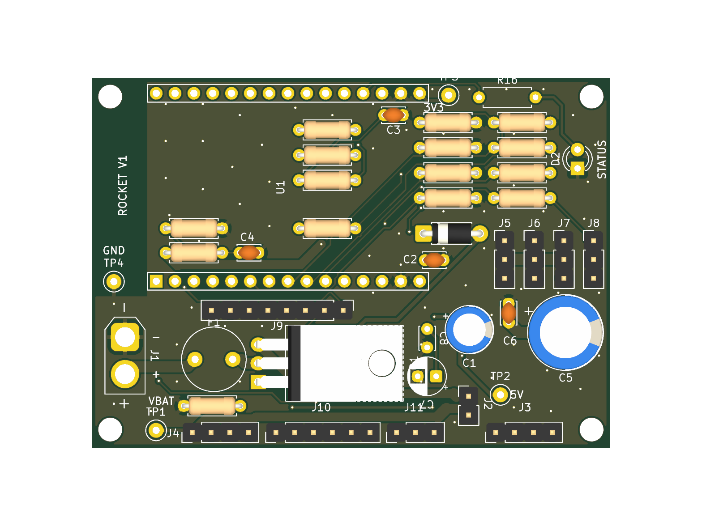
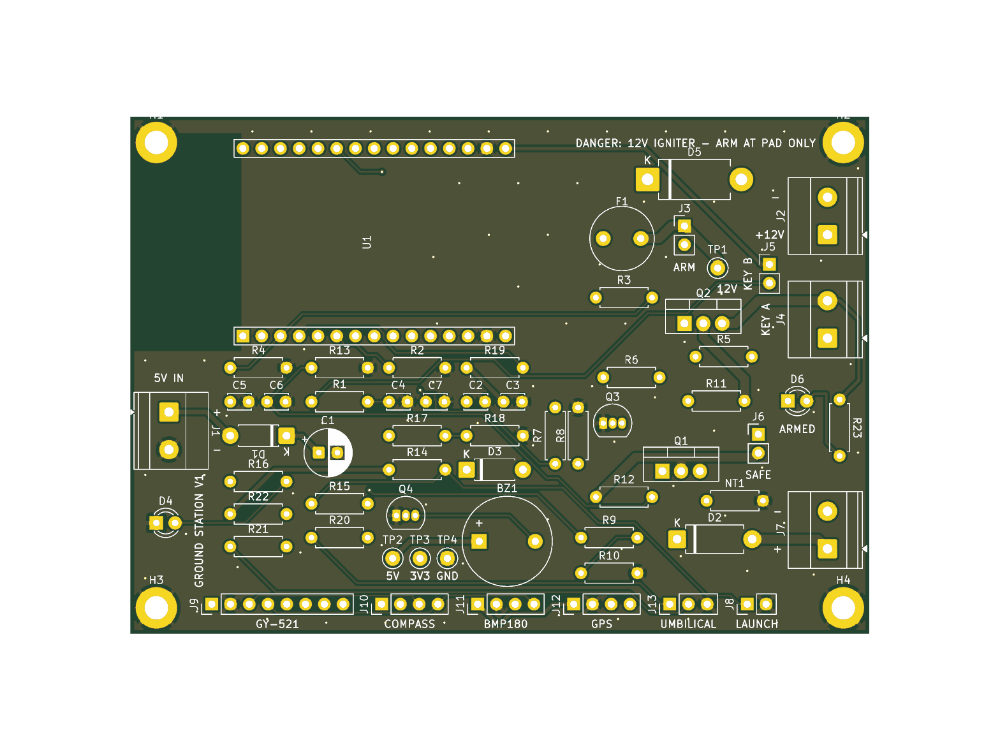

# Rocket Launcher

Open hardware for a hobby model-rocket system built around two ESP32 boards:

| Board | What it does | Size | Version |
|---|---|---|---|
| [Rocket V1 flight computer](docs/rocket-v1.md) | Flies in the rocket. Drives four canard servos, reads an IMU and logs to microSD. | 70 × 50 mm, 2 layers | V1 |
| [Ground Station V1 launch controller](docs/ground-station-v1.md) | Stays at the pad. Arms and fires the igniter, checks continuity, and reads GPS, compass and barometer. | 100 × 70 mm, 2 layers | V1 |

Both boards are through-hole only, so they can be hand-soldered, and both use a socketed 30-pin ESP32 DevKit V1. They talk to each other before launch over a 3-wire serial umbilical.

Designed by **Ashton W** in KiCad 10.

| Rocket V1 | Ground Station V1 |
|---|---|
|  |  |

## Safety

The Ground Station switches a 12 V battery into a pyrotechnic igniter. Treat it as live whenever the igniter battery is connected.

- Fit the **SAFE shunt** (J6) whenever you are near the rocket. It shorts the igniter leads together.
- Pull the **ARM plug** (J3) and remove the **key** before approaching the pad.
- The red **ARMED** LED is wired directly to the armed 12 V line. If it is lit, the firing circuit has power, whatever the ESP32 is doing.
- The continuity check passes about 13 µA through the igniter. With the SAFE shunt fitted it reads "connected" whether or not an igniter is attached.
- Follow your national model-rocketry safety code and local law. This design is provided as-is, with no warranty; you are responsible for how you build and use it.

## Documentation

| Document | What it covers |
|---|---|
| [User manual](docs/user-manual.md) | Assembly, bench tests, installation and the launch-day procedure |
| [How it works](docs/how-it-works.md) | Circuit-by-circuit technical description of both boards |
| [Rocket V1](docs/rocket-v1.md) | Connectors, ESP32 pins, test points and known issues |
| [Ground Station V1](docs/ground-station-v1.md) | Firing circuit, connectors, ESP32 pins and known issues |
| [Manufacturing](docs/manufacturing.md) | Ordering the boards from JLCPCB |
| [Changelog](CHANGELOG.md) | What is in this release |

## Repository layout

```
Rocket_V1/           KiCad project: flight computer
Ground_Station_V1/   KiCad project: launch controller
lib/                 Shared ESP32 DevKit symbol and footprint
docs/                Board documentation, schematic PDFs, board renders
  rocket-v1.md
  ground-station-v1.md
  user-manual.md
  how-it-works.md
  manufacturing.md
  schematics/        Schematic PDF and SVG for each board
  images/            Board renders and a prototype photo
*/JLCPCB/            Ready-to-order Gerber zip and parts list for each board
CHANGELOG.md         What is in this release
```

## Opening the projects

1. Install [KiCad 10](https://www.kicad.org/download/) or newer.
2. Open `Rocket_V1/Rocket_V1.kicad_pro` or `Ground_Station_V1/Ground_Station_V1.kicad_pro`.

The ESP32 DevKit symbol and footprint load from `lib/` through a relative path, so the folders must stay side by side as they are here. Every other part comes from KiCad's standard libraries.

Don't want to install KiCad? The schematics are in [docs/schematics](docs/schematics) as PDFs.

## Ordering boards

Each project has a `JLCPCB` folder holding a Gerber zip you can upload as-is, the individual Gerber files, and a parts list. Settings and pre-order checks are in [docs/manufacturing.md](docs/manufacturing.md).

## Status

Both boards pass KiCad's electrical and design rule checks with no errors. **Neither revision has been manufactured or tested yet.** Read the "Known issues" section of each board's page before ordering.

Firmware is not part of this repository. Each board page lists the ESP32 pin assignments needed to write it.

## License

Designed by Ashton W. No license has been chosen yet, so all rights are reserved by default. Add a `LICENSE` file before inviting others to reuse the design. CERN-OHL-P and CC BY-SA are common choices for open hardware.
