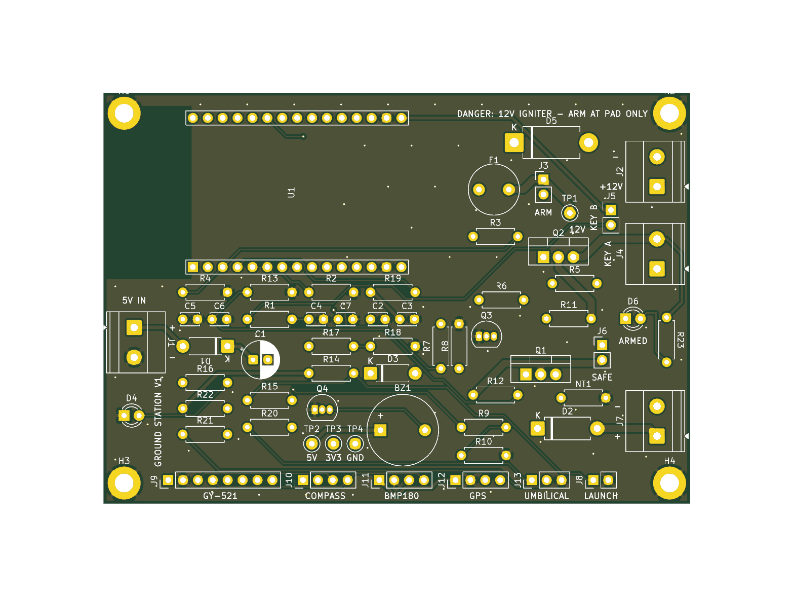
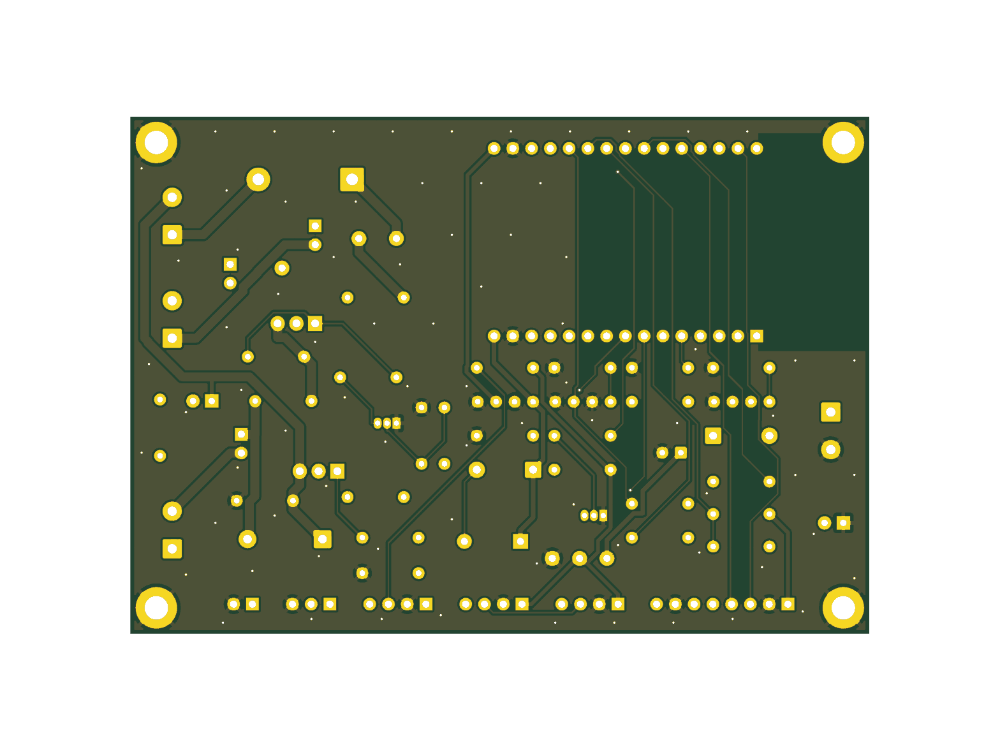

# Ground Station V1 launch controller

A 100 × 70 mm, 2-layer, through-hole board that stays at the launch pad. An ESP32 DevKit arms and fires a 12 V igniter, checks igniter continuity, and reads GPS, compass, barometer and IMU modules.

- Designer: Ashton W
- KiCad project: [`Ground_Station_V1/`](../Ground_Station_V1)
- Schematic: [PDF](schematics/Ground_Station_V1.pdf)
- Parts list: [`Ground_Station_V1/JLCPCB/Ground_Station_V1_BOM.csv`](../Ground_Station_V1/JLCPCB/Ground_Station_V1_BOM.csv)

| Top | Bottom |
|---|---|
|  |  |

An earlier hand-built prototype is shown in [images/Ground_Station_prototype.jpg](images/Ground_Station_prototype.jpg).

## The firing circuit

```
12 V battery + ─ J2 ─ D5 reverse-polarity diode ─ F1 3 A fuse ─ J3 ARM plug ─ J4 key switch ─┬─ Q2 high-side switch ─ J7 igniter + 
                                                                                             └─ ARMED LED (D6)
12 V battery − ─ J2 ───────────────────────────────────── Q1 low-side switch ─────────────── J7 igniter −
```

Current reaches the igniter only when **all** of these are true:

1. The ARM plug (J3) is fitted.
2. The key switch (J4) is on.
3. The ESP32 drives **FIRE_HIGH** (IO25), turning on Q2 through Q3.
4. The ESP32 drives **FIRE_LOW** (IO33), turning on Q1.
5. The SAFE shunt (J6) is removed. With it fitted, firing blows the fuse instead of the igniter.

Both fire pins have pull-downs and are not driven during ESP32 boot or reset, so a crash or restart cannot fire the igniter.

Other parts of the circuit:

- **ARMED LED (D6, red).** Wired from the armed 12 V line to the igniter battery negative through 2.2k. It lights whenever steps 1 and 2 are true, independent of the ESP32.
- **Continuity check.** 470k and 330k resistors pass about 13 µA through the igniter into IO35. With an igniter connected and a 12 V battery, the pin reads about 1.3 V; with no igniter it reads 0 V.
- **Key switch second pole (J5).** Tells the ESP32 on IO32 that the key is on.
- **D2 (P6KE18CA).** Clamps voltage spikes from long igniter leads.
- **NT1.** A single link joining igniter ground to logic ground, so firing current stays out of the logic ground copper.

## Logic power

5 V enters on J1, passes through D1 and feeds the ESP32's VIN pin. 3.3 V comes from the ESP32 DevKit's own regulator. Supply 5.2–5.5 V if you can: D1 drops about 0.4 V, and the regulator needs the headroom during WiFi bursts.

## Connectors

| Ref | Purpose | Pin 1 | Pin 2 | Pin 3 | Pin 4 |
|---|---|---|---|---|---|
| J1 | 5 V in | +5 V | GND | | |
| J2 | Igniter battery, 12 V | + | − | | |
| J3 | ARM plug | Jumper across both pins to arm | | | |
| J4 | Key switch, pole A | In series with the igniter supply | | | |
| J5 | Key switch, pole B | 3V3 | Sense (to IO32) | | |
| J6 | SAFE shunt | Jumper across both pins to short the igniter leads | | | |
| J7 | Igniter (e-match) | + | − | | |
| J8 | Launch button | Signal (active low) | GND | | |
| J10 | QMC5883L compass | 3V3 | GND | SCL | SDA |
| J11 | BMP180 barometer | 3V3 | GND | SCL | SDA |
| J12 | GPS | 3V3 | GND | GPS TX (into ESP32) | unused |
| J13 | Umbilical | TX (out of ESP32) | RX (into ESP32) | GND | |

**J9, GY-521 (MPU6050) module, 8 pins:** 3V3, GND, SCL, SDA, unused, unused, GND (AD0), unused (INT).

## ESP32 pin assignments

| GPIO | Signal | Notes |
|---|---|---|
| IO25 | FIRE_HIGH | High turns on the high-side switch. 1k series, 10k pull-down |
| IO33 | FIRE_LOW | High turns on the low-side switch. 1k series, 10k pull-down |
| IO35 | Continuity sense | About 1.3 V with an igniter connected at 12 V |
| IO39 | Igniter battery voltage | 100k / 27k divider: pin voltage = battery × 0.213 (12 V reads 2.55 V) |
| IO32 | Key switch sense | High when the key is on |
| IO4 | Launch button | Active low, 10k pull-up, 100 nF debounce |
| IO19 | Buzzer | High sounds the buzzer |
| IO18 | Status LED (D4) | |
| IO21 | I²C SDA | GY-521, compass, barometer. Pull-ups are on the modules |
| IO22 | I²C SCL | |
| IO34 | GPS data in | Input-only pin |
| IO16 | Umbilical RX (UART2) | 330 Ω series, 10k pull-up |
| IO17 | Umbilical TX (UART2) | 330 Ω series |

## Test points

| Ref | Label | Net |
|---|---|---|
| TP1 | 12V | Igniter battery, after the fuse |
| TP2 | 5V | Logic 5 V |
| TP3 | 3V3 | 3.3 V rail |
| TP4 | GND | Ground |

## Assembly notes

- Q1 is an **IRF3708**, chosen because it switches fully from a 3.3 V signal. Confirm the pin order of the part you buy is gate, drain, source.
- Q4 is a **PN2222A** (pins: emitter, base, collector).
- F1 is a 3 A fast TR5 fuse.
- H1–H4 are plated M3 holes connected to ground.

## Known issues

- **Not yet manufactured or tested.**
- **GPS header J12 is unverified.** It is wired 3V3, GND, TX, unused. Many NEO-6M modules are ordered VCC, RX, TX, GND and prefer 5 V. Check your module before plugging it in.
- **Compass header J10 has 4 pins.** GY-271 modules have 5; the extra DRDY pin overhangs the header.
- With the SAFE shunt fitted, the continuity check cannot tell whether an igniter is connected.
- The reference labels for H1 and H2 sit just off the board edge. This is cosmetic only.
