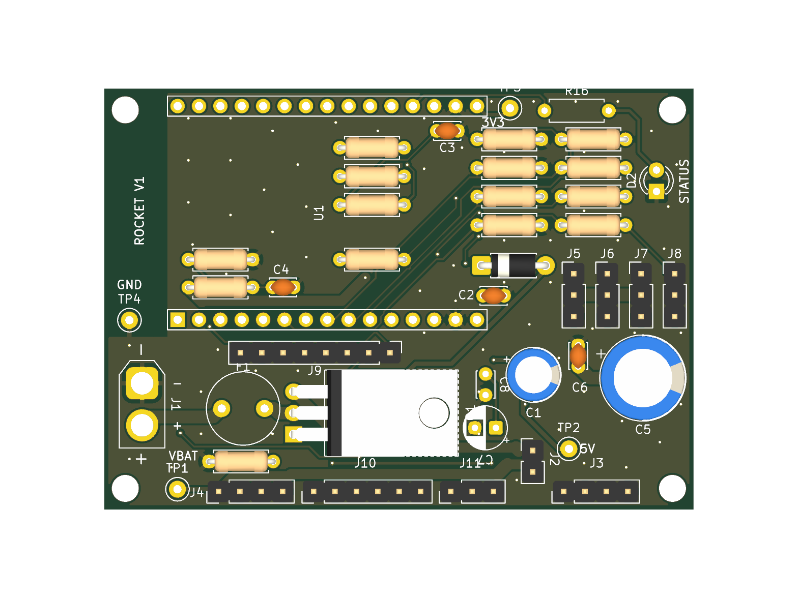
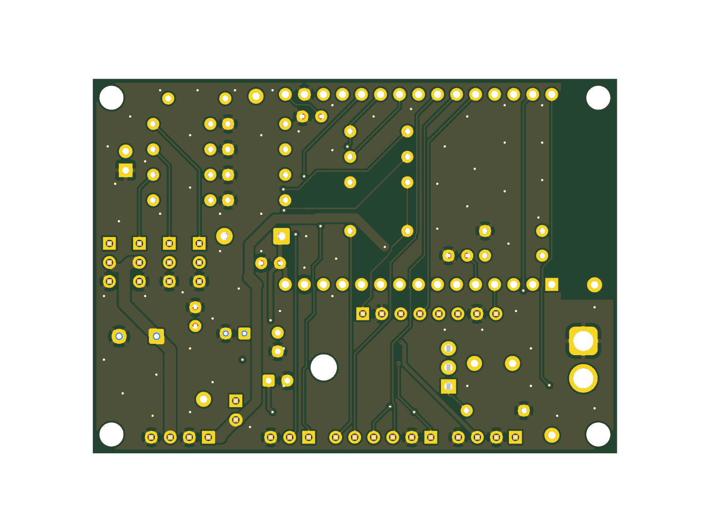

# Rocket V1 flight computer

A 70 × 50 mm, 2-layer, through-hole board that flies in the rocket. An ESP32 DevKit steers four canard servos from an MPU6050 IMU and logs to a microSD card.

- Designer: Ashton W
- KiCad project: [`Rocket_V1/`](../Rocket_V1)
- Schematic: [PDF](schematics/Rocket_V1.pdf)
- Parts list: [`Rocket_V1/JLCPCB/Rocket_V1_BOM.csv`](../Rocket_V1/JLCPCB/Rocket_V1_BOM.csv)

| Top | Bottom |
|---|---|
|  |  |

## How it is powered

```
2S LiPo ─ J1 (XT30) ─ F1 3 A fuse ─ Q1 reverse-polarity protection ─ J2 power switch ─┬─ J3 servo BEC ─ 5 V servo rail ─ J5…J8
                                                                                      ├─ J4 logic BEC ─ D1 ─ +5 V ─ ESP32 VIN
                                                                                      └─ battery voltage divider ─ IO35
```

- **Two separate BECs.** Servo current never passes through the logic supply, so servo stalls don't brown out the ESP32. Both BECs are off-board modules that plug into J3 and J4.
- **3.3 V** comes from the ESP32 DevKit's own regulator and feeds the IMU and the microSD module.
- **Set the logic BEC to 5.2–5.5 V if it is adjustable.** D1 drops about 0.4 V, and the DevKit's regulator needs the headroom during WiFi bursts.

## Connectors

| Ref | Purpose | Pin 1 | Pin 2 | Pin 3 | Pin 4 |
|---|---|---|---|---|---|
| J1 | Battery, XT30 male | GND (chamfered side) | Battery + (flat side) | | |
| J2 | Power switch | From Q1 | To board | | |
| J3 | Servo BEC | Battery out | GND | 5 V servo in | GND |
| J4 | Logic BEC | Battery out | GND | 5 V logic in | GND |
| J5 | Servo LEFT | Signal | 5 V servo | GND | |
| J6 | Servo RIGHT | Signal | 5 V servo | GND | |
| J7 | Servo UP | Signal | 5 V servo | GND | |
| J8 | Servo DOWN | Signal | 5 V servo | GND | |
| J11 | Umbilical | RX (into ESP32) | TX (out of ESP32) | GND | |

**J9, GY-521 (MPU6050) module, 8 pins:** 3V3, GND, SCL, SDA, unused, unused, GND (AD0, selects address 0x68), INT.

**J10, microSD module (3.3 V type), 6 pins:** 3V3, GND, MISO, MOSI, SCK, CS.

The umbilical is wired so that a straight 3-wire cable (pin 1 to pin 1) connects it to the Ground Station's J13.

## ESP32 pin assignments

| GPIO | Signal | Notes |
|---|---|---|
| IO26 | Servo LEFT | 330 Ω series, 10k pull-down |
| IO25 | Servo RIGHT | 330 Ω series, 10k pull-down |
| IO27 | Servo UP | 330 Ω series, 10k pull-down |
| IO32 | Servo DOWN | 330 Ω series, 10k pull-down |
| IO21 | I²C SDA | Pull-ups are on the GY-521 module |
| IO22 | I²C SCL | |
| IO34 | IMU interrupt | Input-only pin |
| IO18 | SD SCK | |
| IO19 | SD MISO | |
| IO23 | SD MOSI | |
| IO4 | SD CS | 10k pull-up |
| IO16 | Umbilical RX (UART2) | 330 Ω series, 10k pull-up |
| IO17 | Umbilical TX (UART2) | 330 Ω series |
| IO35 | Battery voltage | 100k / 47k divider: pin voltage = battery × 0.32 (8.4 V reads 2.69 V) |
| IO2 | Status LED (D2) | Shared with the DevKit's on-board blue LED |

## Test points

| Ref | Label | Net |
|---|---|---|
| TP1 | VBAT | Battery, after the fuse and power switch |
| TP2 | 5V | Logic 5 V (ESP32 VIN) |
| TP3 | 3V3 | 3.3 V rail |
| TP4 | GND | Ground |

## Assembly notes

- **Check the XT30 polarity against your battery lead before first power-up.** Positive is on the flat side of the connector, marked "+" on the board.
- Glue down the tall capacitors (C5 especially) and secure the ESP32 in its socket, or solder it in. Launch vibration can work both loose.
- Q1 (IRF4905) lies flat on the board.
- F1 is a 3 A fast TR5 fuse. Don't fit a larger one: the power switch header J2 is only rated for about 3 A.

## Known issues

- **Not yet manufactured or tested.**
- **Verify the pin order of your microSD and GY-521 modules** against J10 and J9. Breakout boards vary.
- C7 and C8 (the microSD supply capacitors) sit about 20 mm from the header because there is no room beside it.
- A few reference labels overlap or run off the board edge (R16, TP3, D2, C7/J11, Q1). This is cosmetic only.
- One unused via sits on the 5 V track near C1. It is harmless.
